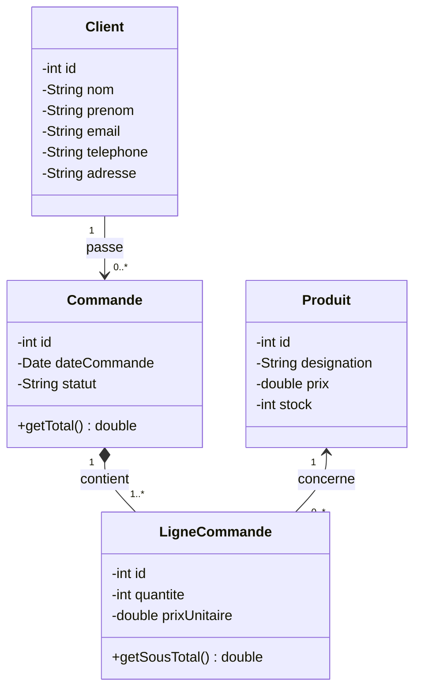

# Mini-rapport — Atelier : application web JEE (Servlet / JSP / JavaBean) basée sur MVC

**Module :** Standards JEE  |  **Outils :** Eclipse, Maven, Tomcat 9, MySQL 8

## 1. Objectif
Maîtriser les standards JEE (Servlet, JSP, JavaBean) en développant une application web de gestion des
commandes de plusieurs clients, structurée selon le patron **MVC**.

## 2. Étape 1 — Diagramme de classes



`LigneCommande` est la classe d'association entre `Commande` et `Produit` (relation plusieurs-à-plusieurs),
elle porte la quantité et le prix unitaire figé au moment de la commande.

## 3. Étape 2 — Schéma de base de données (MySQL)
Règles de traduction : une classe → une table ; une association 1-* → clé étrangère côté « * » ;
la classe d'association → table avec deux clés étrangères.

| Table | Colonnes principales | Clés étrangères |
|---|---|---|
| `client` | id, nom, prenom, email (unique), telephone, adresse | — |
| `produit` | id, designation, prix, stock | — |
| `commande` | id, date_commande, statut, client_id | `client_id → client.id` (RESTRICT) |
| `ligne_commande` | id, commande_id, produit_id, quantite, prix_unitaire | `commande_id → commande.id` (CASCADE), `produit_id → produit.id` (RESTRICT) |

Script complet : `sql/schema.sql`.

## 4. Étape 3 — Projet Maven
Projet Web dynamique (Servlet 4.0) converti en Maven (packaging `war`). Dépendances du `pom.xml` :
`javax.servlet-api`, `jsp-api`, `jstl`, `mysql-connector-java`, `weld-servlet-shaded` (CDI : `@Inject`,
`@ApplicationScoped`) et `javax.annotation-api`.

## 5. Étape 4 — Couche persistance / modèle
| Package | Contenu |
|---|---|
| `ma.fstt.entities` | JavaBeans : `Client`, `Produit`, `Commande`, `LigneCommande` |
| `ma.fstt.service` | Interfaces : `GenericService<T>`, `ClientService`, `ProduitService`, `CommandeService` |
| `ma.fstt.dao` | Implémentations JDBC `@ApplicationScoped` : `ClientDao`, `ProduitDao`, `CommandeDao`, + `DBConnection` |

Les DAO sont injectés dans les servlets avec `@Inject` sur l'**interface** (couplage faible).
`CommandeDao` enregistre la commande et ses lignes dans une **transaction** (commit / rollback).

## 6. Étape 5 — Contrôleurs et vues
| Espace | Servlet | Vues JSP (`WEB-INF/views`) | CRUD |
|---|---|---|---|
| Client | `/clients` | `client/list.jsp`, `client/form.jsp` | liste, création, modification, suppression |
| Produit | `/produits` | `produit/list.jsp`, `produit/form.jsp` | liste, création, modification, suppression |
| Commande | `/commandes` | `commande/list.jsp`, `form.jsp`, `detail.jsp` | liste, détail, création, modification, suppression |

Les JSP n'utilisent **aucun scriptlet** : uniquement EL et JSTL (`c:forEach`, `c:if`, `c:url`, `c:out`, `fmt:*`).
Les vues sont placées sous `WEB-INF` : elles ne sont accessibles que via les servlets.

## 7. Architecture MVC
```
Navigateur ──► Servlet (Contrôleur) ──► Service/DAO ──► MySQL
                   │                        │
                   │  JavaBean (Modèle) ◄───┘
                   └──► JSP (Vue, EL + JSTL) ──► Navigateur
```
Remarque : le sujet mentionne « MVC 1 » ; comme les requêtes passent par des servlets contrôleurs avant
d'atteindre les JSP, l'architecture réalisée correspond en pratique au **modèle 2** (MVC avec contrôleur central),
qui est la forme recommandée du patron.

## 8. Choix techniques et limites
* Tomcat 9 (espace de noms `javax.*`) ; Tomcat 10+ exigerait la migration vers `jakarta.*`.
* Le prix d'une ligne est copié depuis le produit au moment de la commande (historique conservé).
* Une suppression est refusée (message d'erreur) si le client ou le produit est référencé (clés étrangères).
* Non traité : gestion du stock à la commande, authentification, pagination.

## 9. Conclusion
L'atelier a permis de mettre en pratique la chaîne complète : modélisation UML → schéma relationnel → projet
Maven → couche DAO → servlets → JSP/JSTL, avec injection CDI et séparation claire des responsabilités MVC.

*Code source : (lien GitHub à ajouter)*
